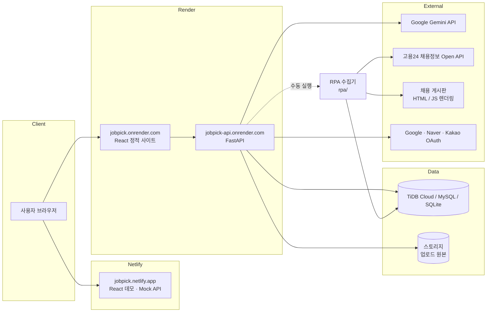
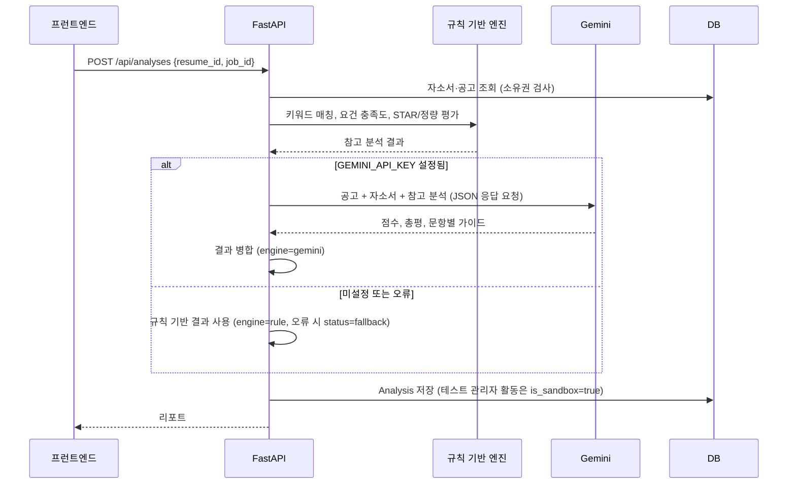

# 02. 시스템 아키텍처 설계서

## 1. 전체 구성



| 계층 | 기술 | 역할 |
|---|---|---|
| 프런트엔드 | React 19, Vite 8, Tailwind CSS v4, React Router 7, FontAwesome | SPA, 권한별 라우트 가드, Mock 모드 |
| 백엔드 | Python 3.11, FastAPI, SQLAlchemy 2, PyJWT, bcrypt | REST API, 인증, 분석, 관리자 |
| AI | Google Gemini (`google-genai`) + 규칙 기반 엔진 | 공고 정형화, 적합도 분석, 가이드 생성 |
| RPA | Requests, BeautifulSoup4, Playwright, pypdf, Tesseract | 공고 수집, 자소서 OCR |
| 데이터 처리 | pandas, NumPy | 관리자 통계 집계, 점수 분포 |
| 인프라 | Render, Netlify, GitHub Actions, Docker Compose | 배포, CI/CD, 로컬 통합 실행 |

## 2. 디렉터리 구조

```plaintext
jobpick/
├── backend/
│   ├── app/
│   │   ├── main.py            # FastAPI 앱, CORS, 라우터 등록, 시드
│   │   ├── config.py          # .env 로딩
│   │   ├── database.py        # SQLAlchemy 엔진/세션
│   │   ├── models.py          # ORM 모델 (User, JobPosting, Resume, Analysis ...)
│   │   ├── schemas.py         # Pydantic 입출력 스키마
│   │   ├── security.py        # 비밀번호 규칙, bcrypt, 권한별 JWT
│   │   ├── deps.py            # 권한 의존성 (user / sandbox / admin)
│   │   ├── seed.py            # 초기 데이터
│   │   ├── routers/           # auth, oauth, jobs, resumes, analyses, admin
│   │   └── services/          # analyzer, keywords, resume_parser, stats, auth_service
│   ├── scripts/create_admin.py
│   ├── tests/                 # pytest
│   └── Dockerfile
├── rpa/
│   ├── collectors/            # sample, worknet, html_board, playwright_board
│   ├── normalizer.py          # 공고 정형화 (섹션 분리, 키워드, Gemini 보조)
│   ├── pipeline.py            # 수집 → 정형화 → upsert → 실행 이력
│   ├── ocr.py                 # PDF/이미지/TXT 텍스트 추출
│   ├── run.py                 # CLI 진입점
│   └── data/sample_jobs.json  # 오프라인 샘플 공고 (프런트 Mock 과 공유)
├── frontend/
│   └── src/
│       ├── api/               # http.js(실 API), mock.js(데모), session.js(세션 분리)
│       ├── components/        # layout, ui, home, ReportView, JobCard ...
│       ├── context/           # AuthContext(세션 2종), ToastContext
│       ├── lib/               # analyzer.js(Mock 분석), password.js, format.js
│       └── pages/             # 서비스 페이지 + admin/
├── docs/                      # 산출물
├── .github/workflows/deploy.yml
├── render.yaml · netlify.toml · docker-compose.yml
└── requirements.txt · .env.example
```

## 3. 분석 처리 흐름



### 적합도 점수 산식 (규칙 기반)

| 영역 | 가중치 | 계산 |
|---|---|---|
| 핵심 키워드 매칭 | 35% | 공고 키워드 중 자소서에 등장한 비율 (동의어 사전 48개 항목) |
| 자격요건 충족도 | 25% | 요건별 키워드/토큰 일치 비율 평균 |
| 우대사항 충족도 | 10% | 동일 |
| 인재상 부합도 | 10% | 동일 |
| 문장 완성도 | 20% | 분량(400~1,200자), 수치 성과, STAR 요소, 추상적 표현 감점 |

등급 기준은 다음과 같습니다.

| 점수 | 등급 |
|---|---|
| 80점 이상 | 합격 가능성 높음 |
| 60점 이상 | 합격 가능성 보통 |
| 40점 이상 | 보완 필요 |
| 40점 미만 | 전면 수정 권장 |

## 4. RPA 수집 흐름

1. `CrawlSource` 의 `kind` 에 맞는 수집기를 실행합니다. 수집기 종류는 `sample`, `worknet`, `html`, `playwright` 입니다.
2. `html`·`playwright` 수집기는 실행 전 robots.txt 를 확인하고, 요청마다 `CRAWL_DELAY_SECONDS` 만큼 대기합니다.
3. `normalizer.normalize()` 가 원본 공고를 정형화합니다.
   - 설명문에서 자격요건·우대사항·인재상 섹션을 분리합니다. 분리되지 않으면 Gemini로 보조 추출합니다.
   - 키워드를 추출하고 직무를 분류합니다.
4. `(source, external_id)` 기준으로 upsert 합니다. 신규 건수와 갱신 건수를 `CrawlRun` 에 기록합니다.
5. 실행 방법은 세 가지입니다.
   - 관리자 화면의 "지금 실행" (FastAPI BackgroundTasks)
   - CLI: `python -m rpa.run --all`
   - 외부 스케줄러: Render Cron Job, GitHub Actions schedule 등

## 5. 인증·세션 분리 구조

자세한 내용은 [06_권한_매트릭스.md](06_권한_매트릭스.md)를 참고하세요.

| 세션 | 서명 키 | aud | 만료 | 프런트 저장소 |
|---|---|---|---|---|
| 일반 사용자 | `USER_JWT_SECRET` | `jobpick:user` | 12시간 | localStorage `jp_user_session` |
| 테스트 관리자 | `USER_JWT_SECRET` | `jobpick:sandbox` | 2시간 | localStorage `jp_user_session` |
| 정식 관리자 | `ADMIN_JWT_SECRET` (별도) | `jobpick:admin` | 30분 | sessionStorage `jp_admin_session` |

## 6. 실행 모드

| 모드 | 조건 | 용도 |
|---|---|---|
| Mock(데모) | `vite --mode demo` 또는 `VITE_USE_MOCK=true` 또는 API 주소 없음 | Netlify 데모. 브라우저 localStorage 가상 DB 사용 |
| API 연동 | `VITE_API_BASE_URL` 지정 | 로컬 개발, Render 프런트엔드 |
