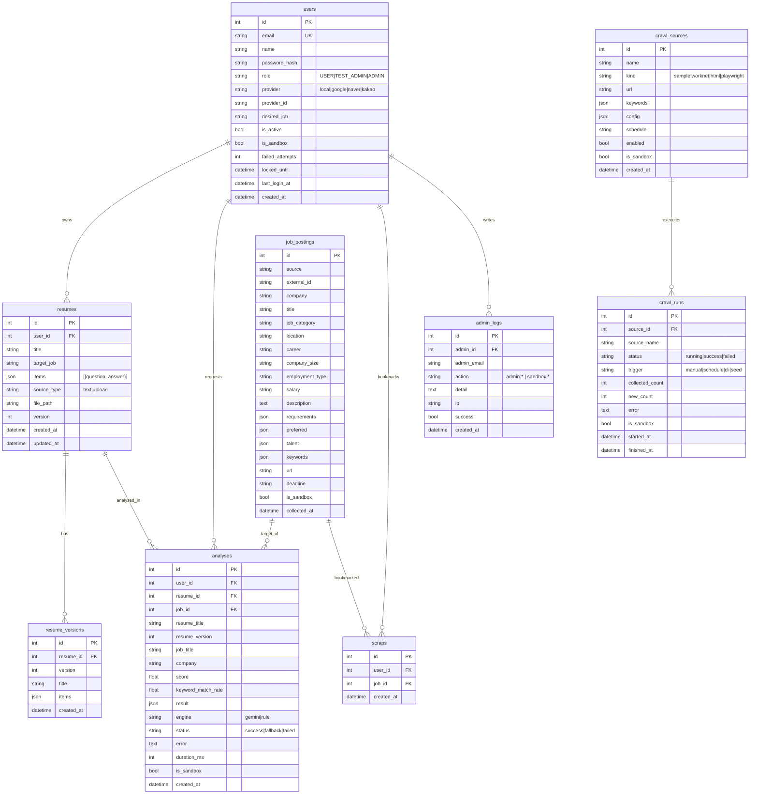

# 03. 데이터베이스 설계서 (ERD)

- DBMS는 환경에 따라 다릅니다.
  - 운영: TiDB Cloud (MySQL 호환)
  - 로컬 Docker: MySQL 8.4
  - 로컬 기본: SQLite
- ORM은 SQLAlchemy 2 (`backend/app/models.py`)이며, 서버 시작 시 `create_all` 로 테이블을 생성합니다.
- 시각은 모두 UTC(naive)로 저장하고, 프런트엔드에서 로컬 시간으로 변환해 표시합니다.
- 운영 데이터와 샌드박스 데이터는 `is_sandbox` 컬럼으로 분리합니다. 관리자 API는 범위(scope)에 맞는 행만 조회·변경합니다.

## 1. ERD



## 2. 테이블 정의

### users — 회원

| 컬럼 | 타입 | 제약 | 설명 |
|---|---|---|---|
| id | INT | PK | |
| email | VARCHAR(255) | UNIQUE, INDEX | 로그인 이메일 (소문자 저장) |
| name | VARCHAR(100) | NOT NULL | |
| password_hash | VARCHAR(255) | NULL | bcrypt. 소셜 전용 계정은 NULL |
| role | VARCHAR(20) | INDEX | `USER` / `TEST_ADMIN` / `ADMIN` |
| provider / provider_id | VARCHAR | | 소셜 로그인 식별 |
| is_active | BOOL | | 비활성 계정은 로그인 불가 |
| is_sandbox | BOOL | INDEX | 샌드박스 더미 회원 |
| failed_attempts / locked_until | INT / DATETIME | | 로그인 실패 잠금 |

### job_postings — 채용 공고

- 유니크 키는 `(source, external_id)` 입니다. 수집기는 이 키로 upsert 합니다.
- `requirements`, `preferred`, `talent`, `keywords` 는 문자열 배열(JSON)입니다.

### resumes / resume_versions — 자소서와 버전 이력

- `items` 는 `[{ "question": "...", "answer": "..." }]` 형식의 JSON 입니다.
- 수정할 때마다 `version` 이 1씩 증가하고, 새 내용이 `resume_versions` 에 스냅숏으로 쌓입니다.
- 복원도 새 버전으로 기록합니다. 이력은 삭제되지 않습니다.

### analyses — AI 분석 결과

`result`(JSON)에는 다음 항목이 들어갑니다.
- 점수 관련: `summary`, `grade`, `section_scores`
- 키워드: `matched_keywords`, `missing_keywords`
- 요건별 충족 여부: `requirements`, `preferred`, `talent`
- 평가와 가이드: `strengths`, `improvements`, `question_feedback[]`, `next_actions`

자소서나 공고가 삭제되어도 리포트는 남도록 FK는 `SET NULL` 로 두고, 제목·회사명을 함께 저장합니다.

### crawl_sources / crawl_runs — RPA 수집 대상과 실행 이력

- `config` 예시 (HTML 수집기):
  ```json
  {"item": "ul.jobs > li", "fields": {"title": ".title", "company": ".company", "link": "a@href"}}
  ```
- 대시보드의 일별 수집량과 출처별 성공률은 `crawl_runs` 를 pandas 로 집계한 값입니다.

### admin_logs — 관리자 접속·변경 로그

- `action` 접두사로 영역을 구분합니다.
  - `admin:` — 운영
  - `sandbox:` — 샌드박스
- 로그인 실패도 `success=false` 로 기록합니다.

## 3. 인덱스·성능 고려

- 목록 필터 컬럼에 인덱스를 둡니다.
  - `job_postings.job_category`
  - `job_postings.collected_at`
  - `analyses.created_at`
  - `crawl_runs.started_at`
- 관리자 통계는 최근 N일(7~60일) 범위만 조회합니다.
- 연결 설정은 `pool_pre_ping`, `pool_recycle=280` 입니다. TiDB Serverless 의 유휴 연결 종료에 대비한 값입니다.
