# 05. 화면 설계서

## 1. 디자인 시스템

| 항목 | 정의 |
|---|---|
| 비주얼 컨셉 | **"공고와 나를 맞대어 딱 맞는 기회를 고른다(Pick)"** — 매칭 게이지, 키워드 연결선, 체크(Pick) 모티프 |
| 컬러 | Ink(남색 계열 기본), Pick `#5B5BF7`(브랜드·행동), Match `#18C99A`(일치·성공), Sun `#F5A524`(가이드·샌드박스), Coral `#FF6B6B`(누락·실패) |
| 타이포그래피 | 제목 **IBM Plex Sans KR** (500/600/700), 본문 **Pretendard Variable** |
| 아이콘 | FontAwesome Free 7 (solid / regular / brands) 일관 적용 |
| 모션 | 카드 진입(slide), 키워드 연결선(scale-x), 점수 카운트업, 스크롤 진입 페이드업, 드로어 슬라이드. `prefers-reduced-motion` 사용자는 모션 최소화 |
| 반응형 | 모바일(~639px) / 태블릿(640~1023px) / 데스크톱(1024px~). 1024px 미만에서 햄버거 메뉴 |

## 2. 공통 레이아웃

| 요소 | 사양 |
|---|---|
| 전역 헤더 | Sticky. 스크롤 시 높이 80→64px, 반투명 블러 배경. 메인 상단에서는 투명(다크 히어로 위) |
| 헤더 구성 | 로고 · GNB(채용 공고 / 자소서 관리 / AI 분석 / 분석 이력) · 사용자 메뉴(이름, 권한 배지, 대시보드, 로그아웃) |
| 상태 띠 | 테스트 관리자 로그인 시 상단 **SANDBOX 모드** 경고 띠(사선 패턴). Netlify 데모에서는 "데모 환경" 안내 띠 |
| 모바일 GNB | 햄버거 3선 → X 자형 전환 모션. 우측에서 좌측으로 열리는 드로어(84%, 최대 384px), 메뉴 항목 순차 등장, ESC/배경 클릭 닫기, 본문 스크롤 잠금 |
| 전역 푸터 | 서비스 소개, 서비스/지원 링크, GitHub·안내 페이지, 팀 정보(박미금 조장, 이오리, 김모란, 홍기흥), 저작권, **To the Top** 버튼 |
| Top 버튼 | 480px 이상 스크롤 시 우하단 플로팅 버튼 등장 + 푸터 버튼. `scrollTo({behavior: 'smooth'})` |
| 관리자 레이아웃 | 전역 헤더·푸터 유지 + 범위 띠(PRODUCTION 남색 / SANDBOX 노랑) + 좌측 사이드바(모바일은 가로 탭) |

## 3. 화면 목록

| ID | 화면 | 경로 | 접근 | 비고 |
|---|---|---|---|---|
| SC-01 | 메인 | `/` | 공개 | 히어로 매칭 인터랙션, 이용 흐름, 최근 공고, 인기 키워드, 샘플 리포트, CTA |
| SC-02 | 로그인 | `/login` | 공개 | Split, 테스트 계정 간편 로그인, 소셜 로그인 |
| SC-03 | 회원가입 | `/signup` | 공개 | 실시간 비밀번호 조건, 비밀번호 확인, 약관 동의 |
| SC-04 | 정식 관리자 로그인 | `/admin/login` | 공개(링크 미노출) | 다크 전용 디자인, OTP(설정 시) |
| SC-05 | 채용 공고 목록 | `/jobs` | 공개 | 검색, 직무 칩, 지역/경력/규모/정렬, 페이지네이션, 스크랩 |
| SC-06 | 공고 상세 | `/jobs/:id` | 공개 | 요건 섹션, "이 공고로 분석하기", 이 공고 분석 이력 |
| SC-07 | 대시보드 | `/dashboard` | 사용자 | 통계 카드, 적합도 추이, 최근 분석, 바로가기, 스크랩 공고 |
| SC-08 | 자소서 목록 | `/resumes` | 사용자 | 카드, 분석/편집/삭제 |
| SC-09 | 자소서 편집 | `/resumes/new`, `/resumes/:id` | 사용자 | 직접 입력/파일 업로드(OCR) 탭, 문항 추가·정렬·삭제, 글자 수, 버전 이력·복원, 이탈 방지 |
| SC-10 | 분석 실행 | `/analysis/new` | 사용자 | 자소서·공고 선택, 진행 단계 애니메이션 |
| SC-11 | 분석 리포트 | `/analysis/:id` | 사용자 | 점수 링, 5개 영역 점수, 키워드, 강점/보완점, 요건 충족, 문항별 가이드·예시, 다음 행동, 이전 대비 증감, 인쇄 |
| SC-12 | 분석 이력 | `/history` | 사용자 | 점수 추이 그래프, 목록, 2건 비교 |
| SC-13 | 관리자 대시보드 | `/admin`, `/sandbox/admin` | 관리자 / 샌드박스 | 수집·분석 KPI, 일별 수집, 일별 분석, 출처별 성공률, 엔진 비율, 점수 분포, 직무별 공고 |
| SC-14 | 회원 관리 | `.../users` | 관리자 / 샌드박스 | 검색, 권한 필터, 권한 변경, 활성/비활성 (확인 모달) |
| SC-15 | 수집 관리 | `.../crawl` | 관리자 / 샌드박스 | 수집 대상 카드, 스케줄 토글, 지금 실행, 추가/수정 모달, 실행 이력 |
| SC-16 | 관리자 접속 로그 | `/admin/logs` | 관리자 | 영역/작업 필터, 실패 강조 |
| SC-17 | 403 / 404 / 약관 / 개인정보처리방침 | `/403`, `*`, `/terms`, `/privacy` | 공개 | |

## 4. 주요 화면

### SC-01 메인 — 히어로 매칭 인터랙션

1. 공고 카드는 왼쪽에서, 자소서 카드는 오른쪽에서 기울어진 채 들어옵니다.
2. 0.9초 뒤 일치하는 키워드가 공고 카드에서 강조됩니다. 동시에 가운데에 연결선과 함께 차례로 나타나고, 자소서 문장에서도 하이라이트됩니다.
3. 마지막으로 적합도 링이 0부터 카운트업되고, 수정 가이드 메모가 나타납니다.
4. 상단 탭으로 예시 공고 3종을 바꾸거나, 같은 탭을 다시 누르면 애니메이션이 재생됩니다.
5. 점수는 실제 분석 엔진(`lib/analyzer.js`)이 계산한 값입니다.

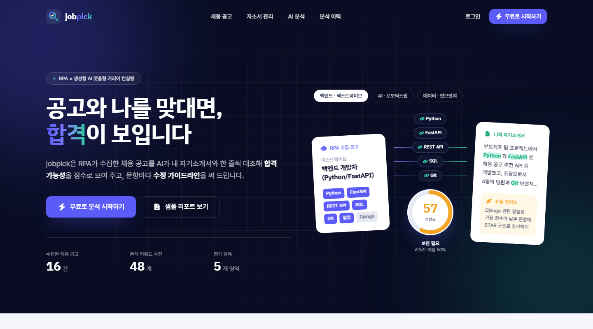

### SC-02 로그인 / SC-04 정식 관리자 로그인

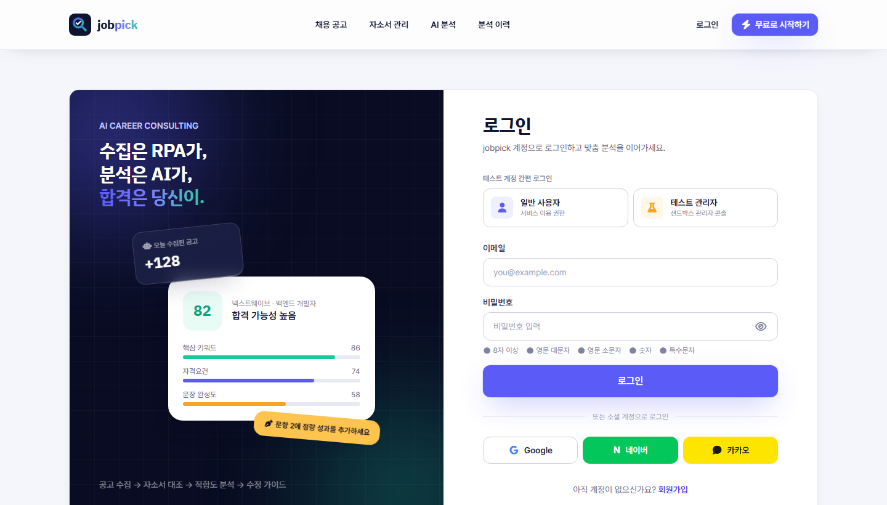

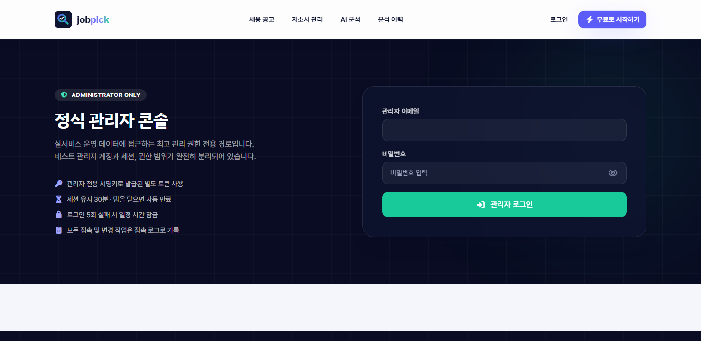

### SC-05 채용 공고 목록

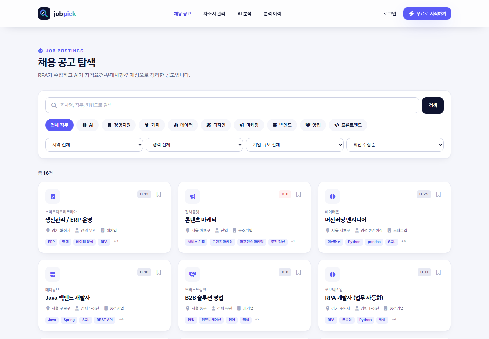

### SC-07 대시보드 · SC-09 자소서 편집

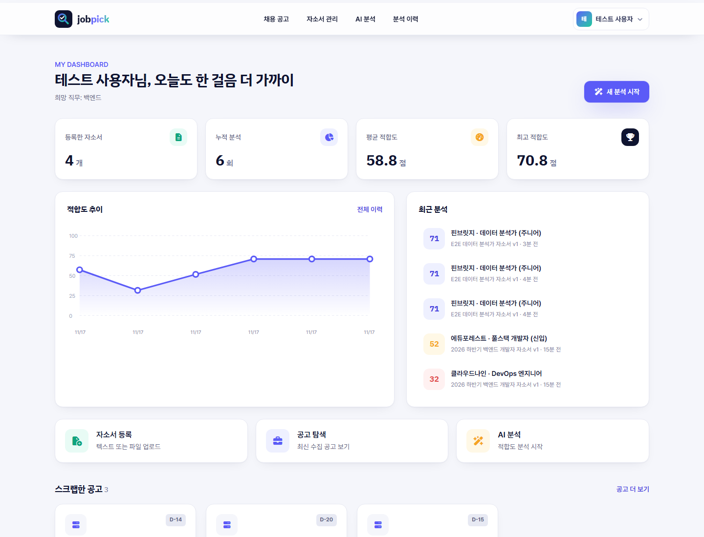

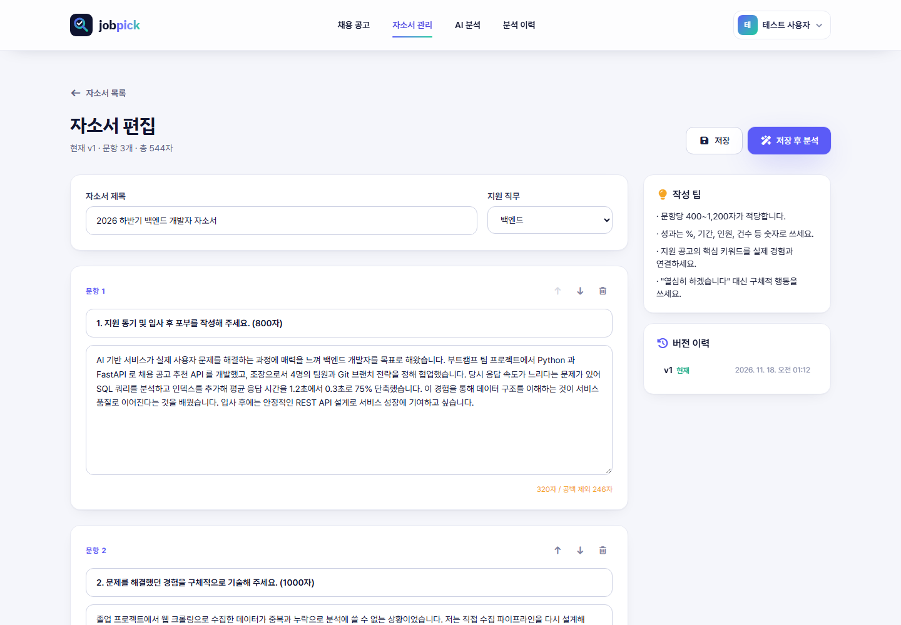

### SC-11 분석 리포트 · SC-12 분석 이력

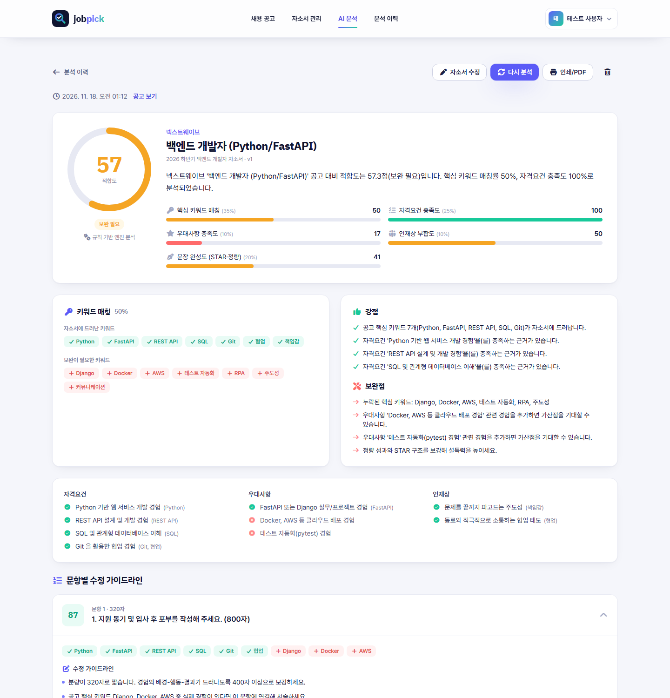

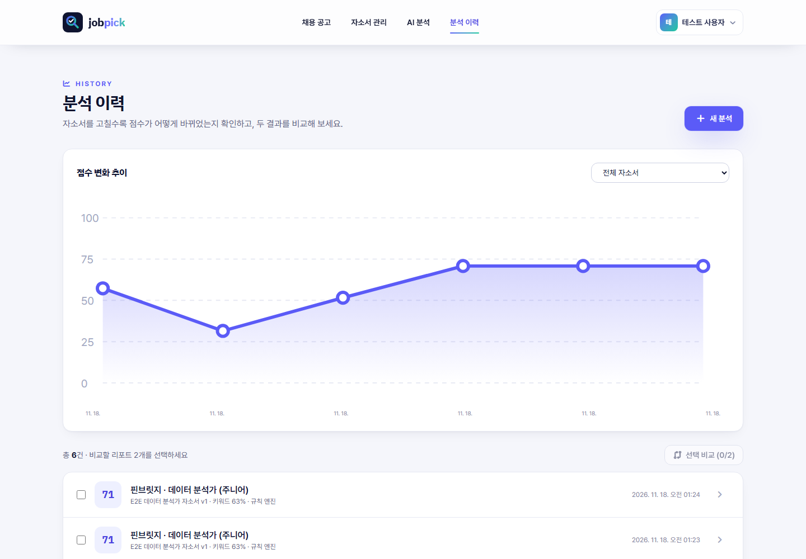

### SC-13~15 관리자 콘솔 (정식 / 샌드박스)

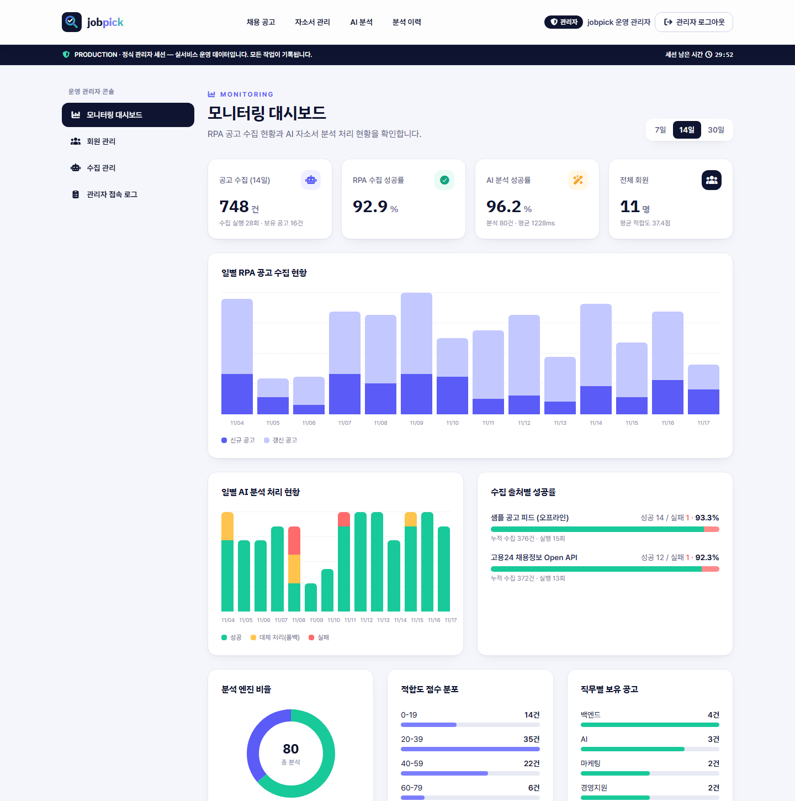

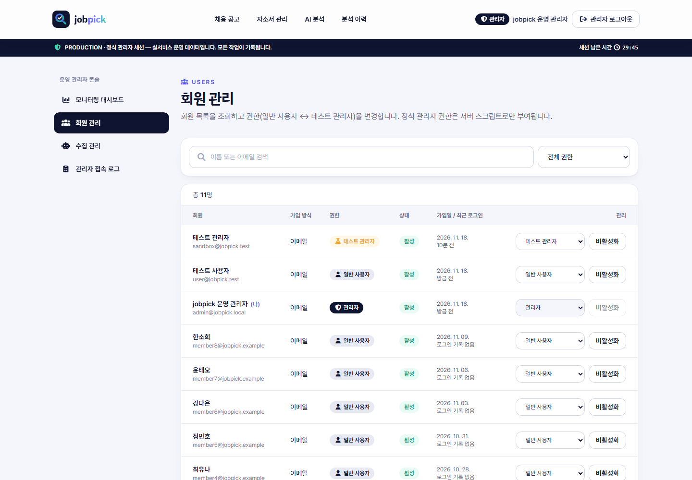

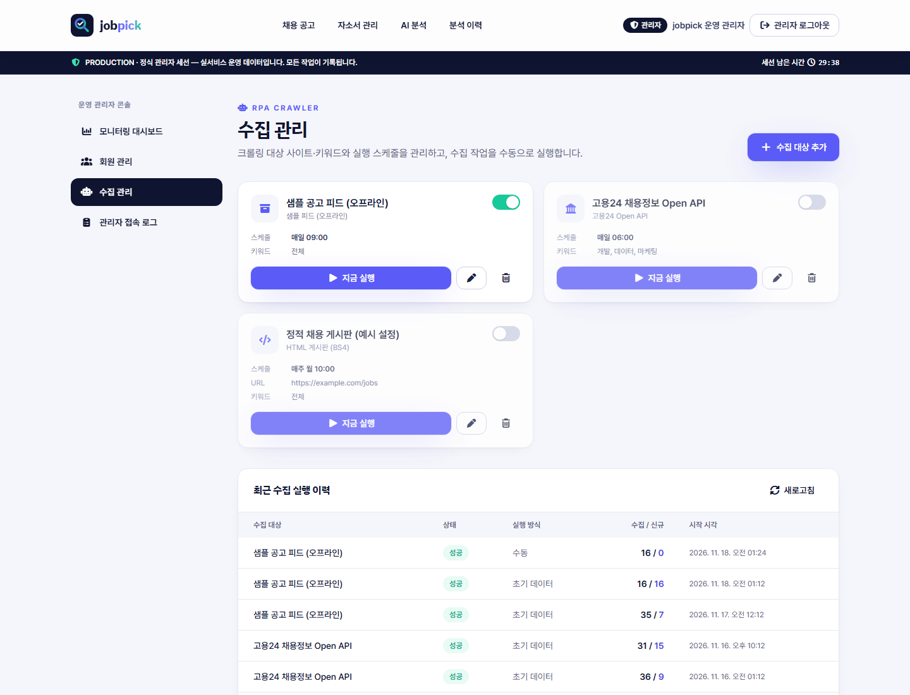

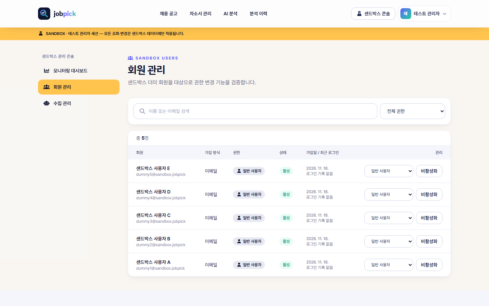

### 모바일 헤더 · 드로어

  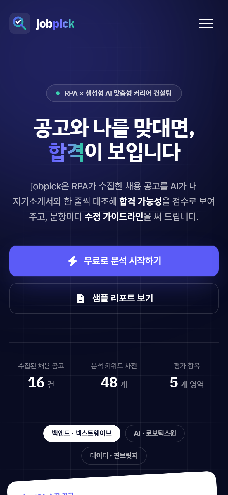
  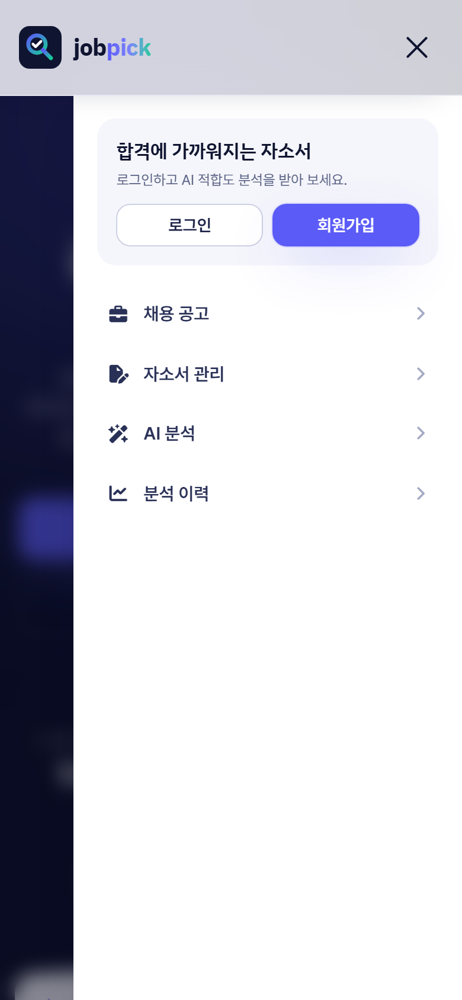

