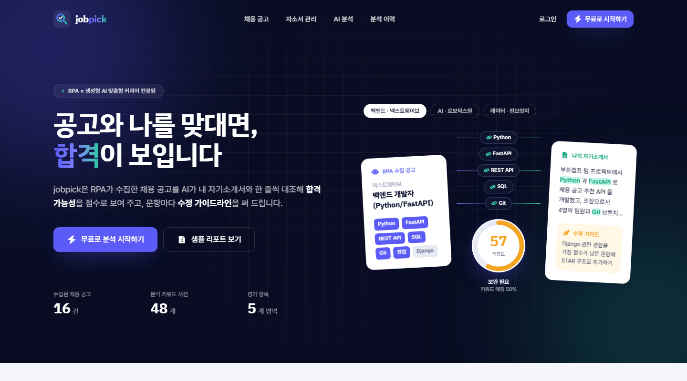

# jobpick — 생성형 AI & RPA 기반 맞춤형 커리어 컨설팅 시스템

> **공고와 나를 맞대면, 합격이 보입니다.**
> RPA가 채용 공고를 수집하면, 생성형 AI가 사용자의 자소서와 대조해 합격 가능성을 분석하고 수정 가이드라인을 써 줍니다.



## 팀

| 이름 | 역할 |
|---|---|
| 박미금 | 조장 |
| 이오리 | 팀원 |
| 김모란 | 팀원 |
| 홍기흥 | 팀원 |

## 주요 링크

| 구분 | URL | 비고 |
|---|---|---|
| GitHub Repository | https://github.com/fsclass-n/jobpick | 소스코드 관리 |
| GitHub Pages | https://fsclass-n.github.io/jobpick/ | 프로젝트 안내 페이지 (`docs/site`) |
| Frontend Demo | https://jobpick.netlify.app | Netlify · Mock 데이터 데모 |
| Frontend | https://jobpick.onrender.com | Render Static Site |
| Backend API | https://jobpick-api.onrender.com | Render Web Service (`/docs` Swagger) |

## 주요 기능

- **채용 공고 자동 수집 (RPA)**
  - 수집 경로: 고용24 Open API, 정적 HTML 게시판(BeautifulSoup4), JS 렌더링 페이지(Playwright)
  - robots.txt 를 준수하고 요청 사이에 지연을 둡니다.
  - 수집한 공고는 자격요건·우대사항·인재상으로 정형화합니다.
- **자소서·이력서 관리**
  - 문항별로 직접 입력하거나 PDF·이미지·TXT 를 업로드합니다. 업로드 파일은 OCR 로 문항을 자동 분리합니다.
  - 수정할 때마다 버전이 저장되고, 이전 버전으로 복원할 수 있습니다.
- **AI 적합도 분석**
  - Google Gemini 와 규칙 기반 엔진이 키워드·자격요건·우대사항·인재상·문장 완성도 5개 영역을 평가해 점수를 매깁니다.
  - 리포트에는 강점·보완점, 문항별 수정 가이드라인과 예시 문장, 다음 행동이 담깁니다.
- **분석 이력**: 점수 추이 그래프와 두 리포트 비교를 제공합니다.
- **권한별 로그인 3종**: 일반 사용자 / 테스트 관리자(샌드박스) / 정식 관리자. 세션·권한 범위·접근 경로가 완전히 분리되어 있습니다.
- **관리자 콘솔**
  - 회원 권한 관리
  - RPA 수집·AI 분석 모니터링 대시보드
  - 수집 대상·스케줄 관리와 수동 실행
  - 관리자 접속 로그

## 기술 스택

| 영역 | 기술 |
|---|---|
| Frontend | HTML5, CSS3, React 19 (Vite), Tailwind CSS v4, React Router 7, FontAwesome, Pretendard + IBM Plex Sans KR |
| Backend | Python 3.11, FastAPI, SQLAlchemy 2, PyJWT, bcrypt, PyOTP, python-dotenv |
| Database | TiDB Cloud (운영) / MySQL 8 (Docker) / SQLite (로컬 기본) |
| Data · RPA | pandas, NumPy, Requests, BeautifulSoup4, Playwright, pypdf, Tesseract OCR |
| AI | Google Gemini API (`google-genai`) + 규칙 기반 분석 엔진(폴백) |
| Infra · CI/CD | Render, Netlify, GitHub Actions, GitHub Pages, Docker, Docker Compose |

## 디렉터리 구조

```plaintext
jobpick/
├── .venv/               # 파이썬 가상환경 (커밋 제외)
├── backend/             # FastAPI 백엔드 (app/, scripts/, tests/, Dockerfile)
├── frontend/            # React + Vite + Tailwind CSS v4 (src/, Dockerfile, nginx.conf)
├── rpa/                 # 공고 수집기, 정형화 파이프라인, OCR, CLI (python -m rpa.run)
├── docs/                # 산출물 (md/, 프로젝트_진행일지/, 산출물/, pdf/, site/, 프로젝트_발표자료.pptx)
├── .github/workflows/   # deploy.yml (영역별 테스트·배포)
├── .env.example         # 환경 변수 예시 (.env 로 복사해 사용)
├── requirements.txt     # Python 통합 라이브러리 목록
├── docker-compose.yml   # db + api + web (+ rpa 프로필)
├── render.yaml          # Render Blueprint (jobpick-api, jobpick)
└── netlify.toml         # Netlify 데모 빌드 설정
```

## 빠른 시작 (로컬)

```bash
# 1) 백엔드
py -3.11 -m venv .venv            # macOS/Linux: python3.11 -m venv .venv
.venv\Scripts\activate            # macOS/Linux: source .venv/bin/activate
pip install -r requirements.txt
copy .env.example .env            # ADMIN_JWT_SECRET, ADMIN_INITIAL_EMAIL/PASSWORD 등 입력
uvicorn backend.app.main:app --reload          # http://localhost:8000/docs

# 2) 프런트엔드 (API 연동)
cd frontend
npm ci
npm run dev                                    # http://localhost:5173

# 프런트엔드만 Mock 데모로 실행 (백엔드 불필요)
npm run dev:demo
```

- 처음 기동하면 테스트 계정, 샘플 공고, 시연용 통계 이력이 자동으로 생성됩니다 (`SEED_ON_STARTUP=true`).
- 정식 관리자 계정은 `.env` 의 `ADMIN_INITIAL_EMAIL` / `ADMIN_INITIAL_PASSWORD` 로 생성됩니다. CLI 로도 만들 수 있습니다: `python -m backend.scripts.create_admin --email ...`
- Docker 로 통합 실행할 수도 있습니다: `docker compose up --build`
  - web: http://localhost:8080, api: http://localhost:8000

### 테스트 계정

| 구분 | 이메일 | 비밀번호 | 로그인 경로 |
|---|---|---|---|
| 일반 사용자 | `user@jobpick.test` | `Jobpick!2026` | `/login` (간편 로그인 버튼) |
| 테스트 관리자 | `sandbox@jobpick.test` | `Sandbox!2026` | `/login` (간편 로그인 버튼) → `/sandbox/admin` |
| 정식 관리자 | `.env` 에 지정한 값 | `.env` 에 지정한 값 | `/admin/login` |
| 정식 관리자 (Netlify 데모 전용) | `admin@jobpick.demo` | `Admin!Demo2026` | `/admin/login` |

## 테스트

```bash
python -m pytest -q             # 백엔드·RPA 19건
cd frontend && npm run build     # 프런트 빌드
```

## 개발 환경 규칙

- 환경 변수는 루트 `.env` 하나로 관리합니다.
  - Vite 도 `envDir: '..'` 설정으로 같은 파일을 읽습니다.
  - Render·Netlify 에는 각 대시보드에서 직접 등록합니다. `.env.example` 에 `[Backend]`, `[Frontend]`, `[RPA]`, `[Secret]` 으로 구분해 두었습니다.
- 파이썬 가상환경은 `.venv`, 라이브러리는 단일 `requirements.txt` 로 관리합니다.
- 배포는 영역별로 나뉩니다 (GitHub Actions paths-filter).

  | 변경된 파일 | 배포 대상 |
  |---|---|
  | `frontend/**` | Netlify 데모 + Render 프런트 |
  | `backend/**`, `rpa/**`, `requirements.txt` | Render API (pytest 통과 후) |
  | `docs/site/**` | GitHub Pages |

## 산출물 (docs)

| 문서 | 위치 |
|---|---|
| 요구사항 정의서 | [docs/산출물/01_요구사항_정의서.md](docs/산출물/01_요구사항_정의서.md) |
| 시스템 아키텍처 설계서 | [docs/산출물/02_시스템_아키텍처_설계서.md](docs/산출물/02_시스템_아키텍처_설계서.md) |
| 데이터베이스 설계서 (ERD) | [docs/산출물/03_데이터베이스_설계서.md](docs/산출물/03_데이터베이스_설계서.md) |
| API 명세서 | [docs/산출물/04_API_명세서.md](docs/산출물/04_API_명세서.md) |
| 화면 설계서 | [docs/산출물/05_화면_설계서.md](docs/산출물/05_화면_설계서.md) |
| 권한 매트릭스 | [docs/산출물/06_권한_매트릭스.md](docs/산출물/06_권한_매트릭스.md) |
| 배포·운영 가이드 | [docs/산출물/07_배포_운영_가이드.md](docs/산출물/07_배포_운영_가이드.md) |
| 테스트 결과서 | [docs/산출물/08_테스트_결과서.md](docs/산출물/08_테스트_결과서.md) |
| 프로젝트 일정 · 진행일지 | [docs/프로젝트_진행일지/](docs/프로젝트_진행일지/) |
| 작업 기록 | [docs/md/](docs/md/) |
| PDF · 발표자료 | [docs/pdf/](docs/pdf/), [docs/프로젝트_발표자료.pptx](docs/프로젝트_발표자료.pptx) — `python docs/build_docs.py` 로 재생성 |
